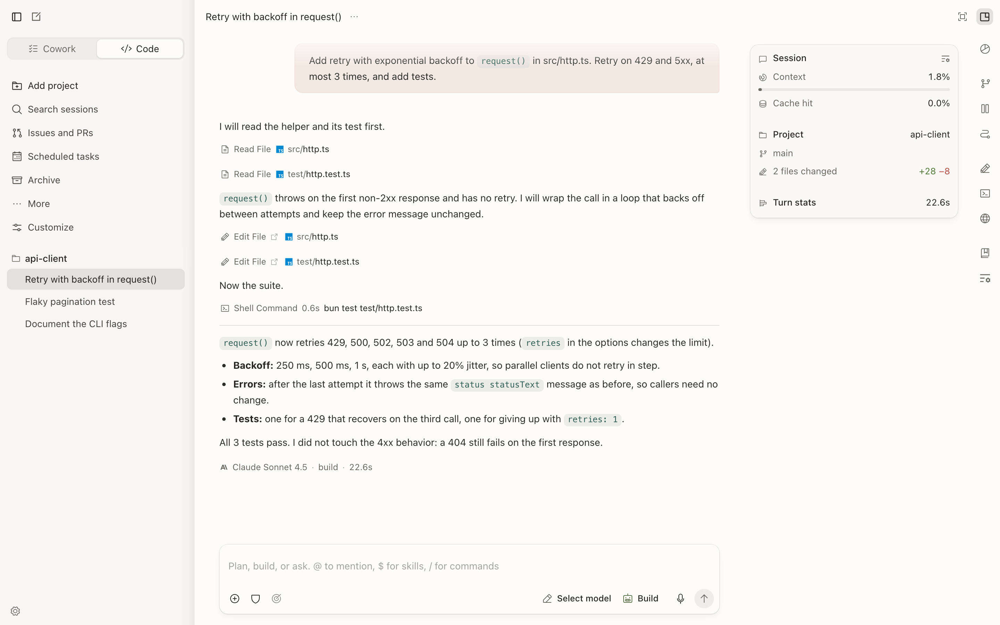
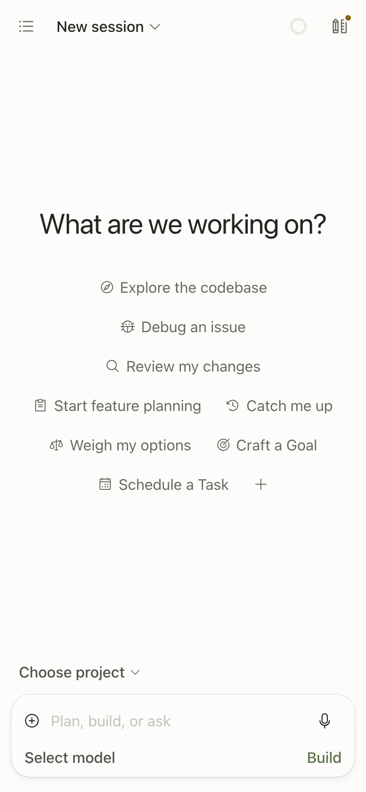
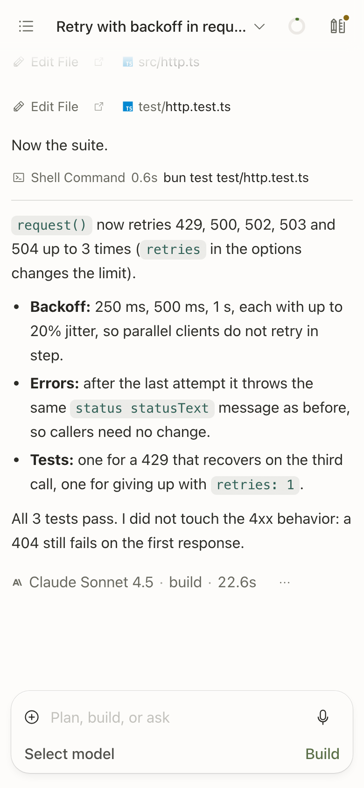

# <picture><source media="(prefers-color-scheme: dark)" srcset="docs/references/badges/openchamber-logo-dark.svg"></picture> Openchamber-Pi

[](LICENSE)
[](https://github.com/openchamber/openchamber)

## OpenChamber on the Pi coding agent

**Openchamber-Pi is a fork of [OpenChamber](https://github.com/openchamber/openchamber) that runs its agents on the [Pi coding agent](https://github.com/earendil-works/pi) instead of OpenCode.**

The workspace is the same: sessions, review, worktrees, scheduling and the desktop, web and mobile surfaces. Underneath, every agent turn is a Pi turn. The fork is merged with upstream through release 2.7.1.

<picture><source media="(prefers-color-scheme: dark)" srcset="docs/references/pi/desktop_dark.png"></picture>

<details>
<summary>More screenshots</summary>

<p>
<picture><source media="(prefers-color-scheme: dark)" srcset="docs/references/pi/mobile_new_session_dark.png"></picture>
<picture><source media="(prefers-color-scheme: dark)" srcset="docs/references/pi/mobile_chat_dark.png"></picture>
</p>

The screenshots show a small demo project with a hand-written conversation, not a recorded run.

</details>

## What changes with Pi

- **One Pi process per live session.** The server starts `pi --mode rpc` for a session that runs a turn, waits on something or was used a moment ago, and closes it after five idle minutes. Details are in [`packages/web/server/lib/pi/DOCUMENTATION.md`](packages/web/server/lib/pi/DOCUMENTATION.md).
- **The UI keeps speaking the OpenCode 2.2.6 dialect.** An in-process bridge on loopback turns Pi's messages and events into the HTTP and SSE shapes the UI, VS Code bridge and server modules already read, so none of them had to be rewritten. [`wire/NOTES.md`](packages/web/server/lib/pi/wire/NOTES.md) lists where Pi's concepts show up differently.
- **Pi's own files hold the configuration.** Agents, commands, skills, MCP servers, compaction, web search and `AGENTS.md` are written to Pi's agent directory (`~/.pi/agent`, or `PI_CODING_AGENT_DIR`). Models and credentials come from Pi.
- **Sessions are Pi's session files.** A session you started with the `pi` command shows up in the list.
- **Folder trust decides approvals.** A project folder you did not trust runs Pi with `--no-approve`, and every tool call passes the gate extension the server loads into each Pi process.

The sidebar has two modes, **Cowork** (standalone chats) and **Code** (projects, pinned and in-work sessions), with the app's pages as labelled rows. On macOS the desktop sidebar can show the window's translucent material.

## Status

| Surface | State |
| --- | --- |
| **Web / PWA** | Runs on Pi from source (below). After the upstream merge it was checked in the browser with stored sessions, not with a live model turn. |
| **Desktop** | The macOS Apple Silicon app is the packaged target. Pi's bundle is unpacked from the app archive so the Pi processes can read it. The packaged build was not re-run after the upstream merge. |
| **Mobile web** | `/mobile.html` on a running server works on a phone. The Capacitor shells in [`packages/mobile`](packages/mobile) connect to a running server and build from source. iOS push needs your own signing profile and APNs key. |
| **VS Code** | Not ported. The extension still starts OpenCode. [`packages/vscode/PI-MIGRATION-NOTES.md`](packages/vscode/PI-MIGRATION-NOTES.md) lists what the port needs. |
| **Releases** | None yet. There is no installer, npm package or store build for this fork. |

Known differences from OpenCode:

- Pi applies neither a per-agent temperature nor a step limit. The agent editor still saves both values.
- The Tasks section of the work status panel reads OpenCode's `todowrite` tool calls, which Pi does not make, so it stays empty.
- Stopping one of several user shell commands in a session stops all of them (`abort_bash`).
- The user interface still says OpenCode in some places. Those texts are being replaced as they are found.

The product features come from OpenChamber and were not re-tested one by one under Pi. The tests of the Pi runtime sit next to it in [`packages/web/server/lib/pi`](packages/web/server/lib/pi). Failing suites at the time of the upstream merge: the Pi bridge test that starts a real Pi child, the VS Code folder-trust proxy test, the Electron packaged-contents test, and two Markdown rendering tests that also fail upstream.

## Run it from source

Requirements: [Bun](https://bun.sh), Node.js 24.14 or newer, and a model you can reach from Pi (an API key or a login, set up in Settings or with `pi`).

```bash
git clone https://github.com/gillmaaan/Openchamber-Pi.git
cd Openchamber-Pi
bun install
bun run dev
```

`bun run dev` starts the server and the UI with hot reload and prints the address. The other entry points:

```bash
bun run build:web         # build the web UI and server
bun run start:web         # serve the built web app
bun run electron:dev      # desktop app in development
bun run electron:build    # package the desktop app (packages/electron)
```

`bun run dev` reads and writes your real OpenChamber settings and Pi sessions. To try it without touching them, give it its own `HOME` and `OPENCHAMBER_DATA_DIR`.

OpenChamber binds to localhost by default. Use `--lan` only on a trusted network and protect browser access with `--ui-password`.

## What OpenChamber offers

These features come from OpenChamber. The guides under `packages/docs` describe upstream and still mention OpenCode where Pi applies now.

- **Session Goals** keep an agent working until a goal is met, blocked or out of budget ([guide](packages/docs/content/docs/session-goals.mdx)).
- **Multi-run** gives one task to up to five models, each in its own session and worktree, and **Fusion** combines the best parts ([guide](packages/docs/content/docs/multi-run.mdx)).
- **Changes Walkthrough** turns a large diff into a guided tour ([guide](packages/docs/content/docs/walkthrough.mdx)).
- **Preview** opens your running app beside the conversation and sends an element, with its styles and errors, to the agent ([guide](packages/docs/content/docs/preview.mdx)).
- **GitHub workflows** start a session from an issue or pull request and send failed checks back to the agent ([guide](packages/docs/content/docs/github.mdx)).
- **Private Relay** pairs a device with a QR code and connects end-to-end encrypted without open ports ([guide](packages/docs/content/docs/private-relay.mdx)); direct, LAN, tunnel and SSH connections also work.
- **Scheduled tasks** run a prompt once, daily, weekly or on a cron schedule.

More guides: [Installation](packages/docs/content/docs/install.mdx), [Connect devices](packages/docs/content/docs/connect-devices.mdx), [Mobile](packages/docs/content/docs/mobile.mdx), [Security](packages/docs/content/docs/security.mdx), [Troubleshooting](packages/docs/content/docs/troubleshooting.mdx). For self-hosting see the [reverse proxy guide](docs/REVERSE_PROXY.md); for themes see the [custom themes guide](docs/CUSTOM_THEMES.md).

## Staying close to upstream

`origin` is this repository and `upstream` is [openchamber/openchamber](https://github.com/openchamber/openchamber). Upstream is merged in, not rebased onto, so the Pi history stays intact:

```bash
git fetch upstream
git merge upstream/main
```

The Pi runtime lives in `packages/web/server/lib/pi`, and the places where this fork deliberately differs from upstream are the Pi bridge, the config routes that write Pi's files, the Electron packaging, the Cowork and Code sidebar, and the texts that name the agent. A conflict elsewhere should go to upstream's version.

Contributions to the product itself, as opposed to the Pi runtime, are best sent to [OpenChamber](https://github.com/openchamber/openchamber/blob/main/CONTRIBUTING.md) first.

## Acknowledgments

- [OpenChamber](https://github.com/openchamber/openchamber) and everyone who contributed to it, for the whole product this fork builds on
- [Pi](https://github.com/earendil-works/pi) for the coding agent, and [OpenCode](https://opencode.ai) for the API shape the UI still speaks
- [Pierre](https://pierrejs-docs.vercel.app/) for the diff viewer and syntax highlighting
- The [T3 Code](https://github.com/pingdotgg/t3code) team for their browser adapter for [libghostty-vt](https://github.com/ghostty-org/ghostty), which the terminal is built on
- [Yulia Ivashko](https://github.com/yulia-ivashko), who built the firework celebration that plays on every successful push

Openchamber-Pi is an independent fork and is not affiliated with the OpenChamber, Pi or OpenCode teams.

## License

MIT
